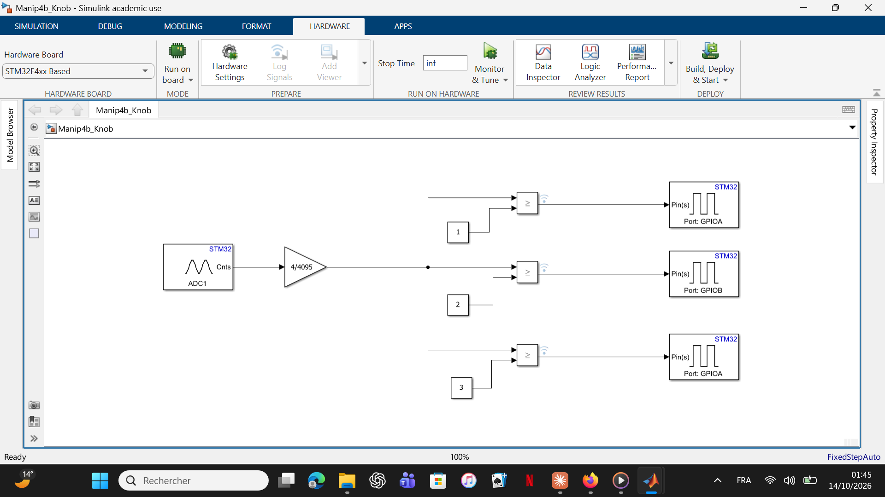
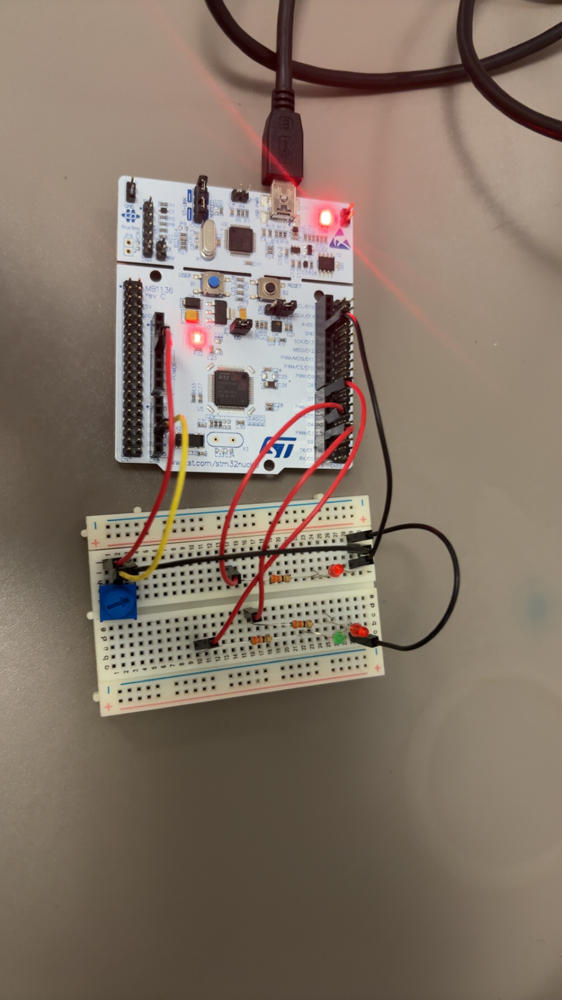

# TP2 — Initiation à la programmation embarquée

**⚠️ Travail de cursus universitaire.** Sujet et cahier des charges fournis par l'Université de Lille (L3 EEA). Carte cible officielle : NUCLEO-F767ZI.

Pour m'entraîner en autonomie avant la séance encadrée, j'ai reproduit la manipulation chez moi, sur mon propre matériel (**NUCLEO-F446RE**).

## Manipulation réalisée : commande de LED par seuils (potentiomètre)

Lecture d'un potentiomètre via l'ADC1, mise à l'échelle du signal (gain 4/4095), puis comparaison à trois seuils qui pilotent l'allumage de LED sur des sorties GPIO.

*Modèle Simulink réel, déployé et fonctionnel sur ma carte.*

*Montage réel : NUCLEO-F446RE + breadboard.*

La vidéo [`media/manip4b_video.mp4`](media/manip4b_video.mp4) montre le montage sous tension : les LED réagissent en direct à la rotation du potentiomètre.

## Contenu

- [`Preparation_TP2.pdf`](Preparation_TP2.pdf) — Réponses théoriques à la préparation du TP (dimensionnement de résistance pour LED, résolution du CAN 12 bits)
- [`guide_cubemx_simulink_tp2.md`](guide_cubemx_simulink_tp2.md) — Guide pas-à-pas de la chaîne CubeMX → Simulink → génération de code C → déploiement (configuration des pins, timebase, External Mode)
- [`media/`](media) — Diagramme Simulink réel, photo et vidéo du montage câblé fonctionnel

## Ce que ce TP m'a permis de comprendre

Le flux **Model-Based Design** : configuration des périphériques (ADC, GPIO) directement via les blocs matériels Simulink, construction de la logique de seuillage par blocs, génération automatique du code C et déploiement sur la carte via la chaîne d'outils STM32CubeIDE pilotée par Simulink ("Build, Deploy & Start") — sans écriture manuelle du code C.

J'ai également exploré l'ajout d'un monitoring temps réel (bloc Scope + External Mode / Monitor & Tune), qui m'a mené à un diagnostic plus poussé : une incompatibilité dans la base de données interne du Hardware Support Package STM32 empêchant la validation automatique du port série virtuel. Diagnostic confirmé par inspection du code source du support package (`validateVirtualComPort.m`) via le débogueur MATLAB — correctif identifié (mise à jour du Hardware Support Package), à appliquer dans une prochaine itération.

## Stack

STM32CubeMX · Simulink (Hardware Support Package STM32) · STM32CubeIDE (toolchain) · NUCLEO-F446RE / F767ZI
